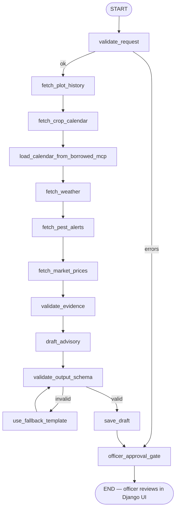

# ARCHITECTURE — Kachieng' AI Agent

> **One-page architecture reference for the African Agentic AI Design Challenge.**
> See also: [Architecture diagram (PDF)](docs/architecture/kachieng_ai_agent_architecture.pdf)

## Agent shape (LangGraph)



The graph is built in `apps/agents/graph.py` with `langgraph.graph.StateGraph`. State is the `AgentState` TypedDict (`apps/agents/state.py`). Each node is a plain function that returns a dict patch. Conditional edges route on errors (missing data, stale sources, model-output invalidity, model unavailable).

**`load_calendar_from_borrowed_mcp`** is the node that exercises the **borrowed** official filesystem MCP server. It reads crop-calendar documents from `docs/calendars/` (either directly for the dev default, or via `npx @modelcontextprotocol/server-filesystem` if `MAJISHAMBA_BORROWED_MCP_USE_NPX=1`) and logs the call to `AuditEvent(tool_name="borrowed_filesystem_mcp")`.

**Validation-retry behaviour.** If `validate_output_schema` finds errors, it routes to the `use_fallback_template` node — **not** back to `draft_advisory`. The fallback template produces guaranteed-valid JSON, which re-validates and proceeds to `save_draft`.

After `officer_approval_gate` the agent stops. Approval happens **outside** the graph, in the Django UI (`apps/approvals/views.py`). Only after the officer approves does the system call `apps.tasks.service.create_follow_up_task_after_approval`, which is the same function the MCP action tool wraps.

## AI model and deployment modes

The `draft_advisory` node calls the provider selected by the `LLM_PROVIDER` environment variable (`apps/agents/llm_provider.py`). Three modes are supported:

| Mode | `LLM_PROVIDER` | Default model | What happens |
|------|-----------------|---------------|--------------|
| Hosted (cloud) | `openrouter` | `qwen/qwen-2.5-7b-instruct` | One HTTP request to OpenRouter's chat-completions endpoint. Requires `OPENROUTER_API_KEY`. |
| Local (open-weights) | `ollama` | `qwen2.5:7b-instruct` | One call to the local Ollama server. Requires Ollama installed and the model pulled. |
| Fallback (no model) | `none` | N/A | No model inference. A deterministic template builds the advisory from collected evidence. |

**Qwen 2.5 7B Instruct** is an open-weights model published under the Apache 2.0 licence on HuggingFace. The challenge explicitly lists Qwen as an example of an open-weights model. The model is used to generate a structured JSON advisory draft. The LLM does not approve advisories, verify facts, or send messages — it only drafts.

`Advisory.generation_mode` records `llm_openrouter`, `llm_ollama`, or `fallback_template`.

## Custom MCP server: `majishamba-extension-mcp`

Built with the official **MCP Python SDK** (`mcp.server.fastmcp.FastMCP`) in `apps/mcp_tools/server.py`. Exposes 8 tools over stdio. The server is intentionally thin — it delegates to the same `TOOL_REGISTRY` functions that the agent and Django views call.

### Eight tools (6 read-only, 2 action)

| Tool | Type | Purpose |
|------|------|---------|
| `get_cluster_plot_history` | Read | List plots and crop season records for a farmer cluster |
| `get_crop_calendar` | Read | Get recommended planting window for a crop in a Migori zone/season |
| `get_weather_and_rainfall_context` | Read | Get rainfall and forecast signals for Nyatike sub-county |
| `get_pest_alerts` | Read | Get active pest alerts for a crop in Migori County |
| `get_market_price_context` | Read | Get recent maize price signals at Migori Town market |
| `validate_advisory_evidence` | Read | Validate that an advisory cites required evidence and is not stale |
| `create_draft_advisory_record` | **Action** | Persist a DRAFT advisory record (no farmer message sent) |
| `create_follow_up_task_after_approval` | **Action (gated)** | Create a follow-up task — requires `OfficerApproval(decision=APPROVED)` |

## Borrowed MCP server: official filesystem MCP server

The official `@modelcontextprotocol/server-filesystem` is used in the `load_calendar_from_borrowed_mcp` graph node to read crop-calendar documents from `docs/calendars/`. Restricted to that directory. Not exposed in production.

## Data flow

```text
Extension Officer (browser) → Django view → LangGraph agent
    → 6 read-only MCP tool calls → borrowed filesystem MCP
    → LLM call (OpenRouter/Ollama/fallback) → Pydantic validation
    → Draft persisted → Officer review → Approval gate
    → Follow-up task (if approved) → Field findings → Supervisor verification
    → All actions logged to AuditEvent
```

## Data sources and persistence

| Source | Type | Evidence |
|--------|------|----------|
| SQLite | Database (default) | `config/settings/base.py` |
| PostgreSQL/PostGIS | Optional production | `USE_POSTGRES=1` |
| Open-Meteo API | External weather (optional) | `apps/integrations/open_meteo.py` |
| Synthetic fixtures | Demo data | `data/fixtures/*.json` |

All household, plot, weather, pest, and market data in the demo is **synthetic**.

## Approval gate design

The gate is **non-negotiable**:
- `create_draft_advisory_record` persists a DRAFT only. No external message is sent.
- `create_follow_up_task_after_approval` checks `OfficerApproval(decision=APPROVED)` before creating a task.
- `ApprovalGateView` is the only path that creates `OfficerApproval` rows. Requires `can_approve()`.
- Decisions: Approve, Reject, Defer, Needs more evidence.

## Role-based access control

| Role | Request? | Approve? | Verify tasks? | Audit log? | Manage accounts? |
|------|----------|----------|---------------|------------|-----------------|
| Extension Officer | Yes | Yes | No | No | No |
| Supervisor | Yes | Yes | Yes | No | No |
| Viewer | No | No | No | No | No |
| System Administrator | No | No | No | Yes | Yes |

Application-role checks — not Django's `is_staff` flag — gate all views and MCP tools.

## Security and governance

- CSRF on all POSTs; HTTPS enforced in production; HSTS, HttpOnly sessions, SameSite=Lax.
- Pydantic validation on tool inputs and model output.
- Structured JSON logging without secrets; `_sanitize_inputs` strips prompt-injection phrases.
- Audit log for every tool call, HTTP mutation, agent run, approval, and task state change.
- Viewer data minimisation: officer names redacted; field-finding content excluded server-side.
- Account approval: registration creates PENDING accounts; `AccountStatusMiddleware` flushes sessions.

## Known limitations

- **Local Ollama inference**: implementation complete, fallback tested, but successful end-to-end local run unverified (EVALS.md Task 13). OpenRouter is the primary path.
- **Task 6**: conflicting weather sources not explicitly cross-checked in fallback template (PARTIAL).
- **Best-effort audit logging**: `log_audit_event` catches exceptions internally.
- **Synthetic data only**: no real farmer records used.

## Architecture diagram

- `docs/architecture/kachieng_ai_agent_architecture.pdf` (1 page, landscape)
- `docs/architecture/kachieng_ai_agent_architecture.png` (high-resolution)
